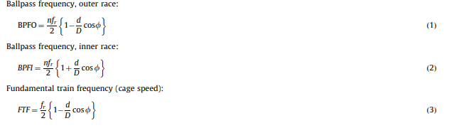
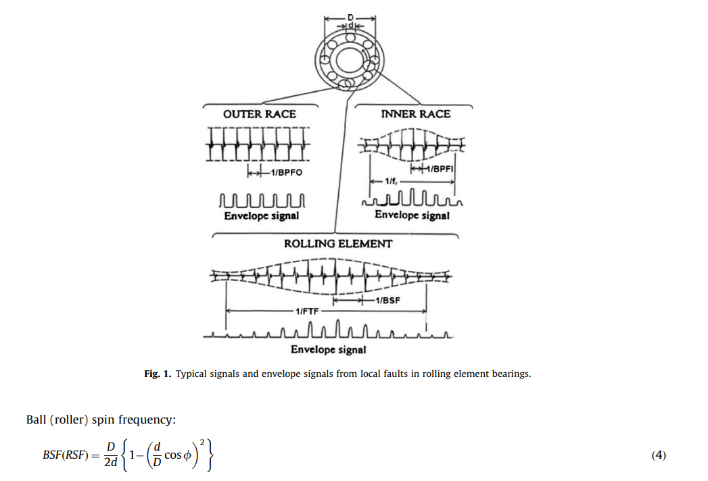

Randall, R. B., & Antoni, J. (2011). Rolling element bearing diagnostics—A tutorial. *Mechanical Systems and Signal Processing*, *25*(2), 485–520. [https://doi.org/10.1016/j.ymssp.2010.07.017](https://doi.org/10.1016/j.ymssp.2010.07.017)